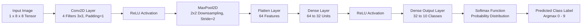

# CNN Image Classifier

[](https://www.python.org/downloads/)
[](https://opensource.org/licenses/MIT)
[](https://docs.pytest.org/)
[](https://github.com/piyush1008-cyber/cnn-image-classifier)
[](https://github.com/piyush1008-cyber/cnn-image-classifier)

> **Modular Convolutional Neural Network (CNN) computer vision classification pipeline written in Python.** Implements 2D spatial convolution (`Conv2D`), max-pooling downsampling (`MaxPool2D`), dense linear layers (`Dense`), ReLU activation, numerically stable Softmax probability output, and multi-class confusion matrix diagnostics.

---

## Network Architecture Overview



---

## Mathematical Formulation

### 1. 2D Spatial Convolution
$$(\mathbf{X} * \mathbf{K})[i, j] = \sum_{m} \sum_{n} \mathbf{X}[i + m, j + n] \cdot \mathbf{K}[m, n] + b$$

### 2. Max Pooling
$$P[i, j] = \max_{0 \le m, n < S} \mathbf{X}[i \cdot S + m, j \cdot S + n]$$

### 3. Numerically Stable Softmax
$$\sigma(\mathbf{z})_i = \frac{e^{z_i - \max(\mathbf{z})}}{\sum_{j=1}^{C} e^{z_j - \max(\mathbf{z})}}$$

---

## Quickstart & CLI Commands

### Run Automated Demonstration
```bash
python main.py demo
```

Output:
```
===================================================================
   CNN IMAGE CLASSIFIER - Computer Vision Convolution Pipeline     
===================================================================
[*] Loading handwritten digits dataset (8x8 grayscale images)...
  - Training samples: 1347 (Tensor: (1347, 1, 8, 8))
  - Test samples:     450 (Tensor: (450, 1, 8, 8))

[*] Initializing Sequential CNN Architecture:
  1. Conv2D      : 4 filters (3x3), stride=1, padding=1 -> Output: (batch, 4, 8, 8)
  2. ReLU        : Activation
  3. MaxPool2D   : 2x2 spatial downsampling -> Output: (batch, 4, 4, 4)
  4. Flatten     : 64 features
  5. Dense       : 64 -> 32
  6. ReLU        : Activation
  7. Dense       : 32 -> 10 classes
  8. Softmax     : Probability Distribution

[*] Executing CNN forward pass on batch of 50 images...
```

---

## Running the Test Suite

```bash
pytest -v
```

Unit and integration tests verify:
- Conv2D spatial dimensions with padding and stride
- MaxPool2D downsampling ratios
- Flatten and Dense tensor dimension matrix multiplication
- Softmax probability normalization ($\sum p_i = 1.0$)
- End-to-end dataset loading and forward inference.

---

## Author & License

- **Author:** Piyush Kangle ([@piyush1008-cyber](https://github.com/piyush1008-cyber))
- **Email:** piyushkangle@gmail.com
- **License:** [MIT License](LICENSE)
